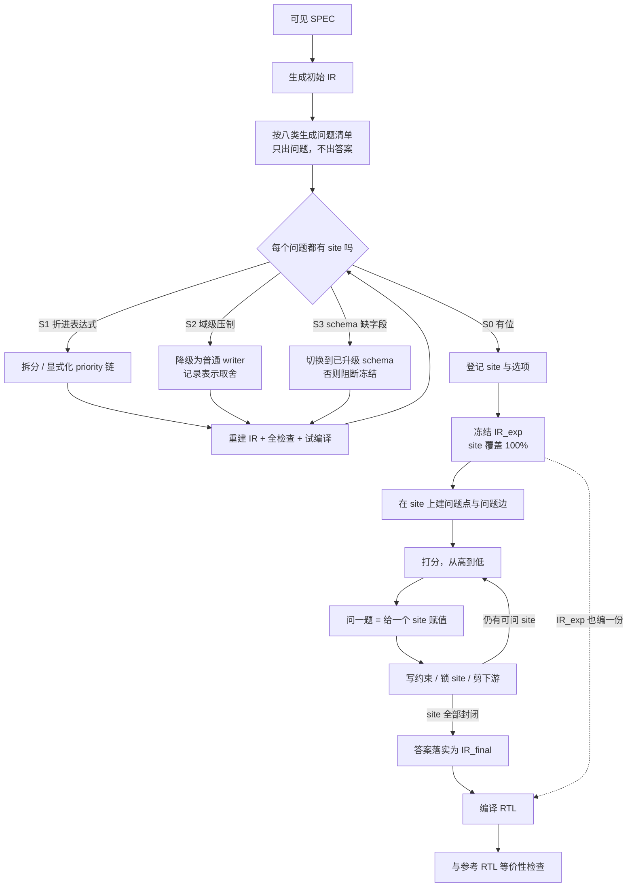

# IR 问题位优先的问题 DAG 实验（spec → IR_exp → 问询 → IR_final → RTL → 等价性检查）

- 状态：主流程已经按八块重排并通过单元测试与历史 FSM 闭环探针；新的五臂批量实验尚未重跑。
- 成功口径：最终 RTL 与 `reference.*` 经 JasperGold 证明等价；小规模纯组合逻辑也可由全输入穷举证明。
  Yosys 有界 SAT 只作 JasperGold 不可用时的诊断，不计作完整等价证明。
- 代码宿主：`dac2026_c1/`（本目录是其子目录，可直接 import 上层模块）。
- 数据集：当前 manifest 位于 `/nas2nfs/homes/2531930/ONE-TURN/DAG/experiment/llm_generation_errors`，
  共 38 例（RTLLM 5 / VerilogEval 23 / Tempo26 10）。论文若固定用 32 例，必须另存冻结 cohort，不能把 32 写死在代码里。
- 八类问题来源：`/home/2531930/nas/2531930-2/ONE-TURN/DAG/DAG_实验流程对齐草案_2026-11-01.md` §3.1。

## 1. 核心判据：一个问题必须先在 IR 里有“位”

“IR 有问题”在本实验里只指一件事：**IR 本身无法体现某个待确认的问题**——问题所指的选择在 IR 里没有可指的对象，因此既问不出来，也改不动。

判定标准不是“schema 有没有字段”，而是**问题位（site）是否存在**。问题 Q 在 IR 里有一个 site，当且仅当存在一组 schema 级、带稳定标识符的对象 O（字段 / transition / priority 边 / state / derived signal），满足：

1. **可编译**：Q 的每个候选答案都能构造成一份 IR，并通过 checker1、checker2、`validate_ir`、`compile_ir`；
2. **局部**：任意两份候选 IR 的差异 ⊆ O，不牵动无关的 guard、action 或 state；
3. **可指认**：O 能被问题文本唯一指到，且打补丁后仍是同一批对象；
4. **可观察**：差异在 horizon 内能从输出看到（否则问了也验证不了）。

四条全过记 `S0`，直接进问题图；任何一条不过，就是下面四种形态之一：

| 形态 | 含义 | 处理 |
| --- | --- | --- |
| `S0` | 有位，但值已由生成器拍定、缺证据 | 直接问，问的是“确认还是改” |
| `S1` | 无位：选择被折进单个表达式 | 实例重构：拆成独立 transition / 显式 priority 链 |
| `S2` | 无位：概念被放在“结构上天然最高优先”的位置 | 实例重构 + 记录表示形态取舍（见下例） |
| `S3` | 无位：schema 根本没有该概念 | 扩 schema，或记 `unaskable` |

## 2. 反例：计数器里 reset 与 full 同时有效，谁优先

本仓库有现成证据（详见 [counter_reset_vs_full.md](capability/witnesses/counter_reset_vs_full.md)）：`examples/counter/ir.yaml` 的 `reset` 是 `clock_domains` 属性，不是 transition，编译结果固定为

```verilog
always @(posedge clk) begin
    if (reset) begin count <= 4'd0; end
    else begin count <= __pn_next_count; end
end
```

`reset` 的优先级由 backend 模板写死。把 `full` 加进 `__pn_next_count` 的优先级链，无论排第几都只在 `else` 分支内生效——**“reset 与 full 谁优先”在这个 IR 里没有节点、没有边、没有字段可指**，是 `S2`。
而同一份 IR 里的 `load_op > clear_op` 是一条显式 `priority` 边，是 `S0`：问题可问，只是值缺证据（`spec.md` 明说未指定）。

让 `S2` 变 `S0` 只有一条正路：把复位从“域级覆盖”降级成同一条优先级链里的一个 writer（`R-a`），代价是生成的 RTL 不再有 `if(reset)` 的域级覆盖——同步复位行为等价，异步复位不等价。这是**表示形态**的取舍，必须逐例核对并写进 `representation_choice`，不能悄悄做。

## 3. 八类问题 → 八种 site 模板

八类（并发优先级、时序关系、边界条件、复位语义、握手协议、状态更新条件、冲突处理、数值及参数约束）不直接等于八个问题，而是八种“问题位”的形状：

| 类别 | site 模板 | site 对象 | 典型失败形态 |
| --- | --- | --- | --- |
| 并发优先级 | `priority_pick` | `priority[]` 的一条边 / `sequential_processes[].transitions` 的顺序 | S1（折成三元）、S2（域级复位压制） |
| 时序关系 | `stage_count` | `pipeline_register` 链长度 + 最后一级的 transition | S1（延迟隐含在组合逻辑里）、S3（`latency>1` 被 validator 拒绝） |
| 边界条件 | `boundary_guard` | 某条 transition 的 `guard` + 满/空派生信号 | S1（边界分支并进 RHS） |
| 复位语义 | `reset_semantics` | `clock_domains[].reset_type/polarity` + `states[].reset_value` | S2（复位期输出无槽位） |
| 握手协议 | `handshake_hold` | 握手状态 + 该 state 在 action 中的出现/缺席 | S1（“保持”是隐式不赋值）、S2（反压稳定性无对象） |
| 状态更新条件 | `hold_on_pause` | 暂停分支对每个 target 的显式赋值 | S1（保持 = 不赋值） |
| 冲突处理 | `mem_conflict` | memory 的读写端口 + bypass 派生信号 | S3（无策略字段） |
| 数值与参数 | `width_overflow` | `states[].width` / `parameters` / 饱和表达式 | S1（溢出行为缺省即截断） |

定义与承载构造版本化在 [eight_categories.yaml](templates/eight_categories.yaml)。

## 4. 目标流程



## 5. 八块计划

| 块 | 名称 | 一句话 | 主要产物 |
| --- | --- | --- | --- |
| 1 | 骨架与角色边界 | 运行契约、角色隔离、八类清单版本化 | `run_config.json`、`events.jsonl` |
| 2 | 问题位模型 | site 判据、S0–S3、八种模板、见证夹具 | `capability/matrix.yaml`、`witnesses/` |
| 3 | 阶段 A：问题位闭环 | 清单 → 找位 → 重构 → 重测 → 冻结 IR_exp | `phase_a/ir_exp.yaml`、`representability.json` |
| 4 | 阶段 B1：问题点与问题边 | 在 site 上建问题图，选项 = 可编译补丁 | `dag/question_graph.json` |
| 5 | 阶段 B2：打分排序 | 固定分母打分，拓扑合法，从高到低 | `rounds/*/ranking.json` |
| 6 | 阶段 B3：询问与剪枝 | 一问、赋值、传播、锁位，直到 site 全封闭 | `rounds/*/answer.json`、`terminal_states.json` |
| 7 | 阶段 C：IR_final 与等价性 | 落实答案、出 RTL、与参考跑 miter | `derived/ir_final.yaml`、`formal/result.json` |
| 8 | 阶段 D：批量与指标 | 多臂对照、消融、失败分类 | `summary.csv`、`report.md` |

### 块 1：骨架与角色边界

统一入口 `src/run_case.py`，一例一个 `runs/<case_id>/<run_id>/`，配置从 `config/default.yaml` 原样抄进 `run_config.json`，案例索引直接读数据集 `manifest.json`。固定三件事：**角色隔离**（求解者只看可见 SPEC 与 IR；回答者可以读 reference RTL，只回选项值与依据条款，不回灌 RTL 片段；检查者只判定不回写）、**预算与重试**（问题预算、重建轮数、每阶段重试上限按草案 §6.3 合并计算，不叠加）、**可追溯**（`events.jsonl` 记阶段、耗时、token、状态迁移，产物全记 sha256）。八类问题作为版本化资源随块 2 一起维护。

### 块 2：问题位模型与判定器

块 2 只描述 schema/编译器的能力边界，版本化矩阵在 `capability/matrix.yaml`；具体某份 IR 要不要拆 transition、补显式保持，属于块 3 的实例重构。判定器会真实构造并编译每个选项，矩阵只提供 `direct / instance_restructure(G2) / schema_extension(G1) / unsupported` 的初始假设，不能盖过编译结果。首批见证使用 `examples/counter/`；FIFO、memory 等见证仍需继续补齐。

### 块 3：阶段 A —— 问题清单、问题位闭环、冻结 IR_exp

先 `generate_ir` 出初始 IR 并跑 checker1/checker2/validate；再按八类生成**完整问题清单**，当前 IR 没位置的问题也必须保留。逐题真实编译所有选项：`S0` 直接登记，G2 先做行为保持重构，再只重填 anchors/patch；问题文字和选项集合用 fingerprint 锁死。每次重构后重跑全部检查、逐字比较重构前后 RTL，并重新判定整张清单。只有覆盖率 100% 才冻结 `phase_a/ir_exp.yaml`。当前版本不会在单次运行中动态修改共享 schema；因此 G1 在 `allow_schema_extension: false` 时会明确阻断冻结，而不是伪装成已经闭环。

### 块 4：阶段 B1 —— 问题点与问题边

用 `assumption_modeling/graph.py::build_graph` 建纯结构 IR 图，并用 compiler source map 增加 `implemented-by` RTL 行区间边。扫描器记录多写者、部分写、无驱动输出、缺 else 路径，再把阶段 A 已闭环的问题挂到这些点上。问题关系单独存为 `anchors_to / changes / depends_on / evidenced_by`，不与 IR 数据边混在一起。为保证冻结语义，块 4 不会在 `IR_exp` 冻结后偷偷发明新选项；未被阶段 A 清单覆盖的扫描点记为 `uncovered_problem_points`，应回到阶段 A 重建基线。JSON 与 Mermaid 两份图都会保留。

### 块 5：阶段 B2 —— 打分与排序

每轮只对 ready 问题打分。`O` 是从锚点到输出的结构可达比例；`D` 在权重非零时调用 `witness.bounded_impact` 比较所有选项；`U` 只计算能实际解锁的依赖下游；`C` 是补丁规模。评分公式为 `O + D + U - C`，具体系数由配置固定。默认权重只启用 O/U；每轮 `ranking.json` 保留分母、缺失原因、实际方法和并列率。不使用 C1 学习模型或学习先验。

### 块 6：阶段 B3 —— 逐题询问、site 赋值与剪枝

严格一次只问一题。答案可来自人工、reference RTL oracle 或回放文件。答案成功编译后才写约束；剪枝不再使用“锚点有重叠”这种宽松规则，而是逐个施加候选补丁，只有在全部已提交锚点约束下只剩一个可行选项时，才记 `resolved_without_ask` 并把该补丁一并提交。延期/不支持的前置题不会错误解锁下游。`other` 或选项外答案记 `requires_new_baseline` 并停止。终态保留 `answered / resolved_without_ask / free_choice / pruned_inapplicable / deferred / unsupported / requires_new_baseline`，问题只是封闭，不会从记录中删除。

### 块 7：阶段 C —— IR_final、RTL 与等价性检查

从冻结 `IR_exp` 重新一次性回放已提交补丁得到 `IR_final`，不信任问答循环里的可变副本。随后重跑检查、逐条核对 patch 与锚点绑定、扫描是否新增问题点；任一门禁失败都在 RTL 前停止。基线和最终版本分别编译、lint、送等价性检查，不再用基线结果掩盖最终版本退化。JasperGold 不可用时运行本地 Yosys 有界 SAT，并明确写 `diagnostic_only_not_equivalence_proof`。

### 块 8：阶段 D —— 批量运行、对照与指标

按 manifest 或显式冻结 cohort 批量执行五臂：`A0_no_question`、`A1_fixed`、`A2_ranked_prune`、`A3_ranked_no_prune`、`A4_random`。指标已经加入闭环前后覆盖率、选项可编译率、重建次数、基线/最终成对结果、改善/退化、终态分布、约束覆盖率、每题 token。跳过闭环与关闭 D 的消融开关尚未单独封装，运行时应使用独立配置文件并保存到 `run_config.json`。

## 6. 目录结构

```text
experiments/ir_question_dag/
├── README.md                  本文件
├── config/default.yaml        运行配置
├── templates/
│   ├── eight_categories.yaml  八类问题 → 八种 site 模板
│   └── questions.yaml         问题边模板（块 4 填）
├── capability/
│   ├── matrix.yaml            八类 × IR 构造的版本化能力矩阵
│   └── witnesses/             见证夹具（含 counter_reset_vs_full.md）
├── src/                       实现代码（逐块添加）
├── cases/                     案例索引
└── runs/<case>/<run_id>/
    ├── phase_a/               init_ir / inventory / site_map / ir_exp
    ├── dag/                   ir_graph / problem_points / question_graph
    ├── rounds/round_XXX/      ready / ranking / question / answer / propagation
    ├── derived/               ir_final / diff / coverage / site_status
    ├── rtl/                   IR_exp 与 IR_final 两套 generated_rtl.v
    └── formal/                golden/candidate/miter/tcl/reports/result.json
```

## 7. 可复用资产（已核对存在）

| 用途 | 位置 |
| --- | --- |
| SPEC→IR | `IRgeneration/ir_generate/gen_petrinet_ir.py::generate_ir` |
| 格式检查/自动修 | `IRgeneration/checker1/checker.py::check_ir` |
| 语义检查/归一化 | `IRgeneration/checker2/checker.py::check_ir` |
| IR 语义约束 | `Compiler/rtl_compiler/validator.py::validate_ir` |
| 补丁式改 IR | `iteration/hw_ir_repair.py::apply_hw_ir_patch / repair_hw_ir` |
| 生成契约/一致性 | `assumption_modeling/pre_ir.py`、`conformance.py` |
| IR 类型化图 | `assumption_modeling/graph.py::build_graph` |
| 决策位点 | `assumption_modeling/decision_inventory.py::ir_inventory` |
| 有界行为差异 | `assumption_modeling/witness.py::bounded_impact / local_difference` |
| 打分骨架 | `DAG/experiment/v4/ranking.py` |
| 冻结与剪枝骨架 | `DAG/experiment/V5/engine.py`（counter 专用，需泛化） |
| IR→RTL | `Compiler/rtl_compiler/compile_ir`（含 source map） |
| 等价性 | `case_in_VE_RM/script/run_rtllm_jaspergold.py`、`dag_failed_cases/verify_dag_rtl.py` |

## 8. 已知风险

- **S2 重构会改变表示形态**：把域级复位降级为普通 writer 后，生成的 RTL 不再有 `if(reset)` 覆盖；同步复位行为等价、异步复位不等价，必须逐例核对并把取舍写进 `representation_choice`。
- **S3 的代价被低估**：扩 schema 要同步改 parser、validator、backend lowering 和两个 checker，还要新增见证 IR。默认 `allow_schema_extension: false`，G1 会阻断本例冻结。
- **有位 ≠ 可判定**：site 存在不代表 `bounded_impact` 能在预算内区分两个选项（深流水线、memory 状态）。块 5 必须允许 `D=unknown` 并降级，而不是当作 0。
- **IR 生成覆盖率未知**：Tempo26 参考 RTL 约 10–14KB，很可能超时；先跑 27 个小例，Tempo26 单独统计。
- **接口一致性**：JG miter 依赖参考与候选的端口名/方向/位宽一致，IR 的 `module.ports` 必须锁死到 SPEC 声明的签名。
- **检查器会就地改写 IR**：`checker1`/`checker2` 会重写文件，冻结副本必须在检查**之后**复制。

## 9. 实现索引（八块 ↔ 代码）

| 块 | 目录 | 关键模块 |
| --- | --- | --- |
| 1 骨架 | `blocks/b1_scaffold/` | `env.py`（代理绕过/密钥）、`config.py`、`cases.py`、`runctx.py`（事件、哈希）、`llm.py` |
| 2 问题位 | `blocks/b2_site_model/` | `schema.py`、`patches.py`、`detect.py`、`capability.py`（能力矩阵 + 具体编译判定） |
| 3 阶段 A | `blocks/b3_phase_a/` | `checks.py`、`inventory.py`（八类清单）、`closure.py`（闭环 + 冻结） |
| 4 问题图 | `blocks/b4_phase_b_graph/` | `graph.py`（IR/RTL source-map 图）、`questions.py`（扫描点、独立问题关系、Mermaid） |
| 5 排序 | `blocks/b5_ranking/` | `rank.py`（O/D/U/C + 缺失特征回退，不使用学习模型） |
| 6 问询 | `blocks/b6_dialogue/` | `answerer.py`（人工/oracle/文件）、`loop.py`（约束赋值、依赖传播与剪枝） |
| 7 阶段 C | `blocks/b7_phase_c/` | `derive.py`、`equivalence.py`（双版本 miter + 远程 JG + Yosys 有界诊断） |
| 8 评测 | `blocks/b8_eval/` | `batch.py`（并发 + 形式化信号量）、`metrics.py`（CSV/报告） |

入口：`src/run_case.py`（单例/批量）、`src/report.py`（汇总）。

```bash
python src/run_case.py fsm --arm A2_ranked_prune
python src/run_case.py --all --arm A2_ranked_prune --workers 3
python src/report.py A2_ranked_prune
```
